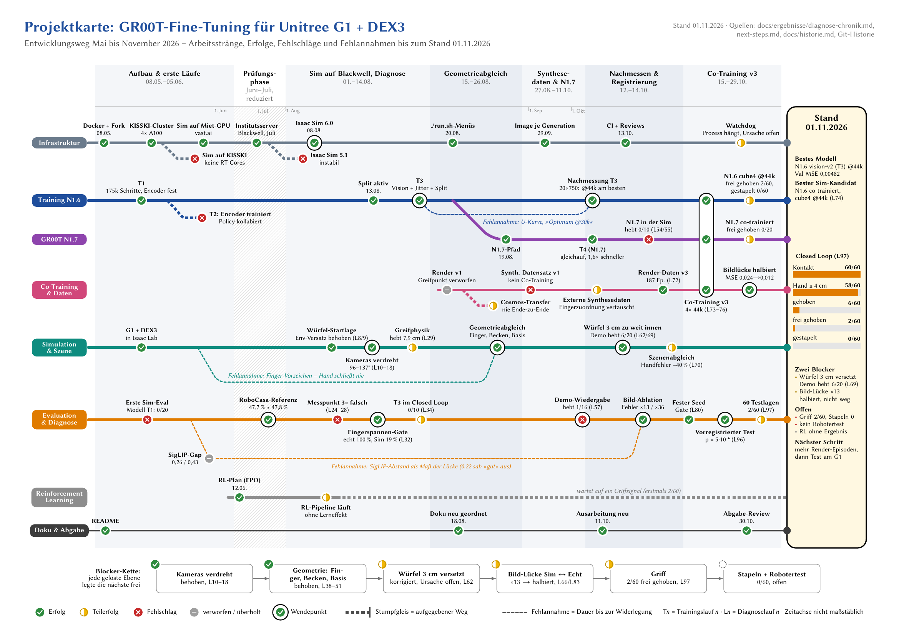

# Projektkarte (U-Bahn-Plan des Projekts)

> **TL;DR:** Eine Abbildung, die das ganze Projekt zusammenfasst: Entwicklungsweg Mai bis
> November 2026 als U-Bahn-Plan mit Erfolgen, Fehlschlägen, Sackgassen und Fehlannahmen bis zum
> Stand 01.11.2026. Sie liegt in vier Varianten vor (Ausarbeitung, Poster, Folien, Repo) und wird
> aus einer TikZ-Quelle gebaut. Die Zahlen selbst stehen in
> [diagnose-chronik.md](../../../docs/ergebnisse/diagnose-chronik.md), nicht hier.



## Varianten

| Datei | Format | Zweck |
|---|---|---|
| [`projektkarte_a4.pdf`](projektkarte_a4.pdf) | A4 quer | ganzseitige Abbildung in der Ausarbeitung |
| [`projektkarte_poster_a1.pdf`](projektkarte_poster_a1.pdf) | A1 quer, 84 × 59,4 cm | Poster: Karte, Ziel und Pipeline, Zahlen, Wendepunkte, Sackgassen, Lessons Learned, Ausblick |
| [`projektkarte_folien.pdf`](projektkarte_folien.pdf) | 3 Folien, 16:9 | 1. Gesamtkarte (reduziert), 2. Stand heute, 3. Wie lange galt ein Irrtum? |
| [`projektkarte.svg`](projektkarte.svg), [`projektkarte.png`](projektkarte.png) | wie A4 | README und Doku im Repo (SVG skaliert verlustfrei, PNG mit 200 dpi) |

## Lesart

- **Linie** = Arbeitsstrang: Infrastruktur, Training N1.6, GR00T N1.7, Co-Training & Daten,
  Simulation & Szene, Evaluation & Diagnose, RL, Doku & Abgabe.
- **Station** = Meilenstein. Die Füllung zeigt den Ausgang: Erfolg, Teilerfolg, Fehlschlag oder
  verworfen/überholt. Ein schwarzer Ring markiert einen Wendepunkt.
- **Stumpfgleis** (gestrichelt, Prellbock) = aufgegebener Weg, etwa Isaac Sim 5.1 oder Trainingslauf T2.
- **Fehlannahme** (dünn gestrichelt, parallel zur Linie) = so lange galt eine falsche Annahme, etwa
  das Finger-Vorzeichen bis zum 24.08. oder die U-Kurve bis zum 12.10.
- **Stand 01.11.2026** (rechts) = alle Linien münden in den aktuellen Stand: bestes Modell,
  Closed-Loop-Stufen (L97), Blocker, Offenes.
- **Laufnummern:** T*n* = Trainingslauf *n* (T1–T4, Auswertungen unter `docs/ergebnisse/`),
  L*n* = Diagnoselauf *n* aus der Diagnose-Chronik.
- Die **Zeitachse ist nicht maßstäblich**: Die Phasen sind nach Ereignisdichte gestreckt; der
  August hat mehr Platz als Juni und Juli. Die Folie „Wie lange galt ein Irrtum?“ nutzt dagegen
  eine echte Zeitachse. Die Monatsmarken oben sind innerhalb jeder Phase linear umgerechnet.

## Bauen

```bash
latex/figures/projektkarte/build.sh      # LuaLaTeX, dvisvgm, pdftoppm; Zwischendateien in build/
```

Die Karte selbst steht nur in [`karte.tex`](karte.tex); Farben, Stationsmarken, Legende und
Blocker-Kette stehen in [`karte_stil.tex`](karte_stil.tex). `karte.tex` wird zweimal gebaut:
`voll` (alle Beschriftungen, für A4, Poster und Repo) und `kurz` (nur Wendepunkte und mit `!`
markierte Stationen, größere Schrift, für die Folie).

Eine Station ergänzen:

```latex
\St*{ok}{18.3}{\yS}{above}{Würfel 3 cm zu weit innen}{Demo hebt 6/20 (L62/69)}
%  * = Wendepunkt, ! = auch auf der Folie beschriften
%  Status: ok | part | fail | old | open;  x = Zeitposition, y = Linie (\yI … \yK)
```

## In die Ausarbeitung einbinden

Die A4-Variante ist für eine eigene Querseite gebaut. Im Satzspiegel (DIV=12, gut 22 × 16 cm)
würde die Schrift auf etwa 5 pt schrumpfen. Eine eigene Seite mit `pdfpages` behält die Schrift
bei rund 6 pt:

```latex
% preamble/packages.tex
\usepackage{pdfpages}
% z. B. am Anfang von Kapitel 7 oder als Anhang
\includepdf[landscape=true, pagecommand={\thispagestyle{empty}}]{figures/projektkarte/projektkarte_a4.pdf}
```

Für eine nummerierte Abbildung mit Bildunterschrift eignet sich `sidewaysfigure` (Paket
`rotating`) mit `\includegraphics[width=\textheight]{…}`. Die Karte wird dann kleiner.

## Quellen

Den Entwicklungsweg liefern diese Quellen (Stand 01.11.2026):

- [`diagnose-chronik.md`](../../../docs/ergebnisse/diagnose-chronik.md) (Läufe 08–97);
- die Laufauswertungen 1–4 unter [`docs/ergebnisse/`](../../../docs/ergebnisse/README.md);
- [`next-steps.md` §0](../../../next-steps.md) und [`docs/historie.md`](../../../docs/historie.md);
- die Git-Historie (301 Commits) und das Claude-Mem-Protokoll.

Die Prüfungsphase (Juni/Juli) lief mit reduziertem Aufwand weiter (RL-Plan, Institutsserver, RoboCasa-Referenz).
